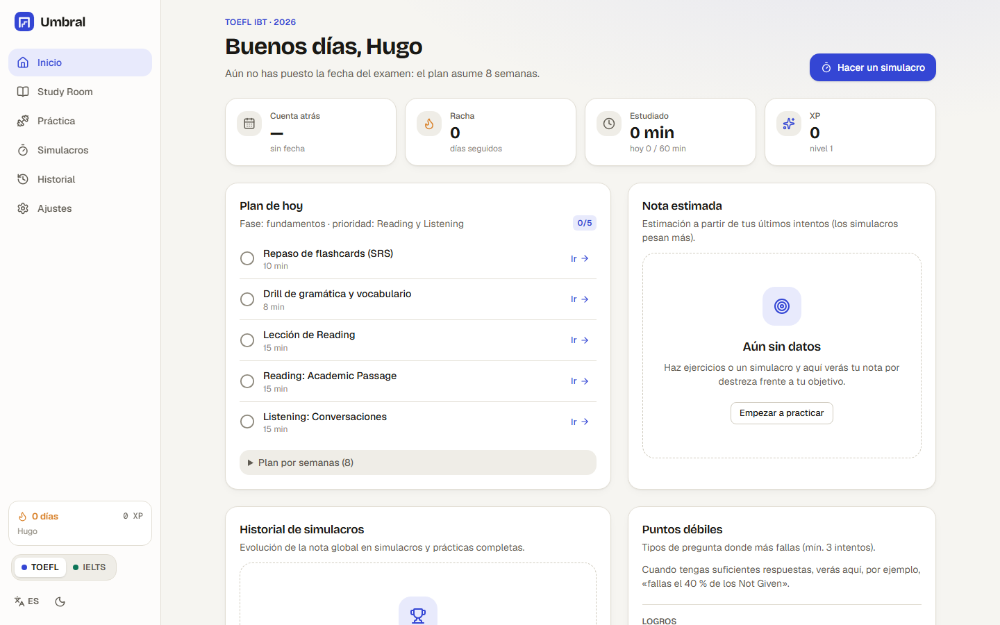
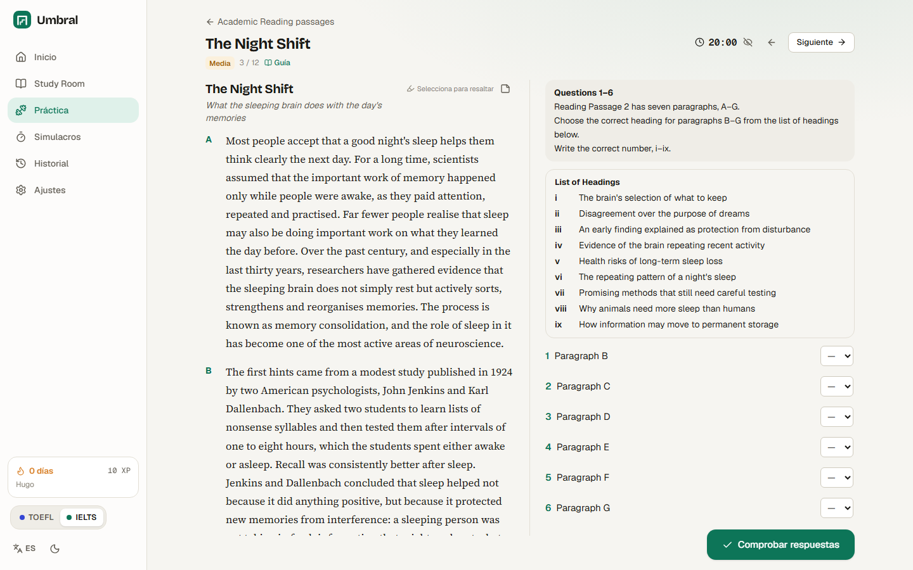
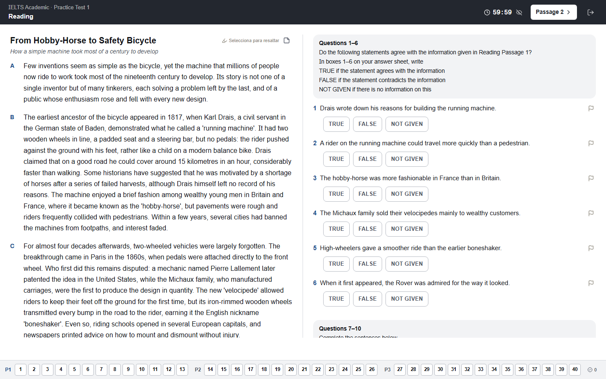
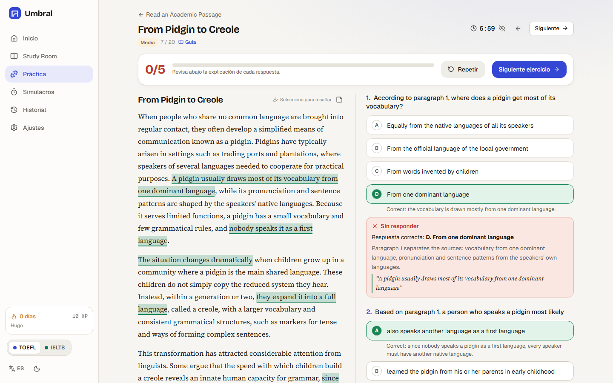
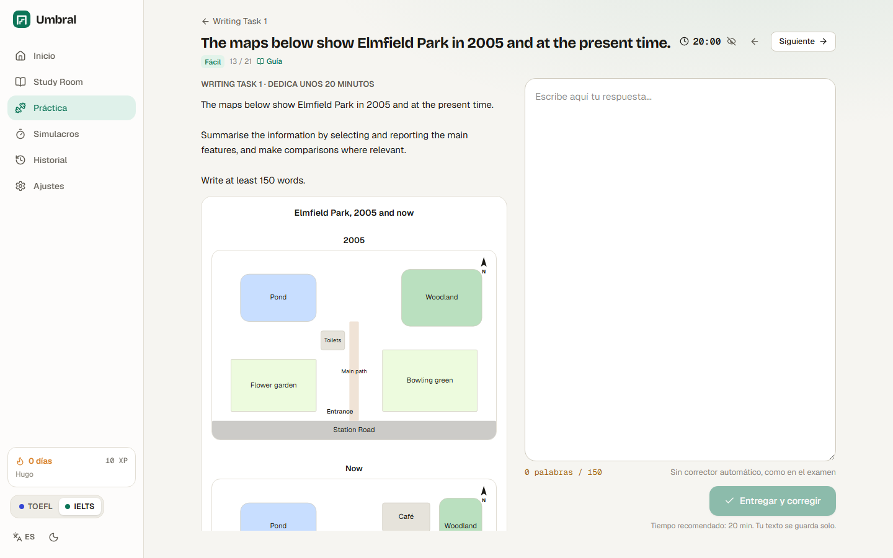
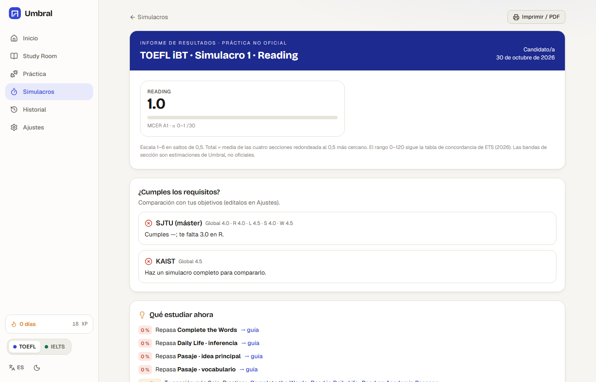
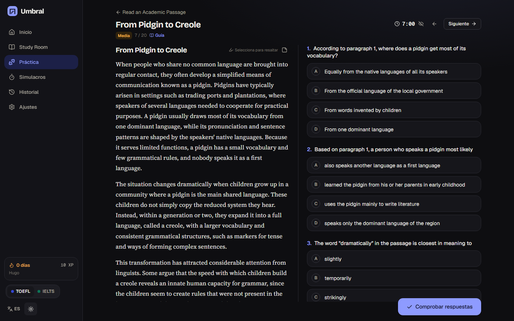
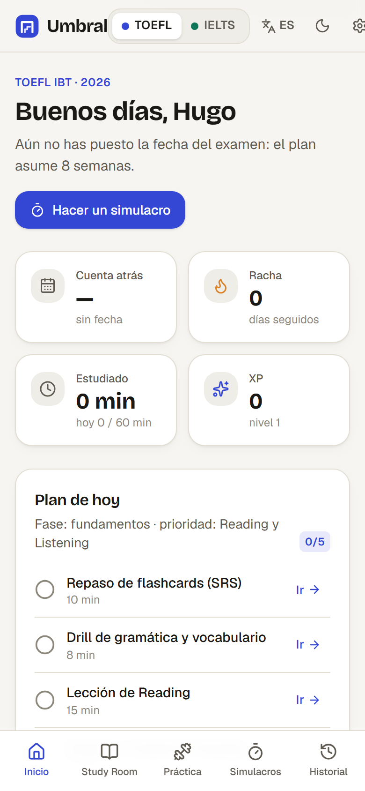
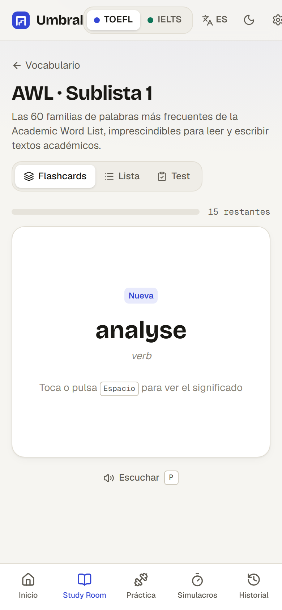
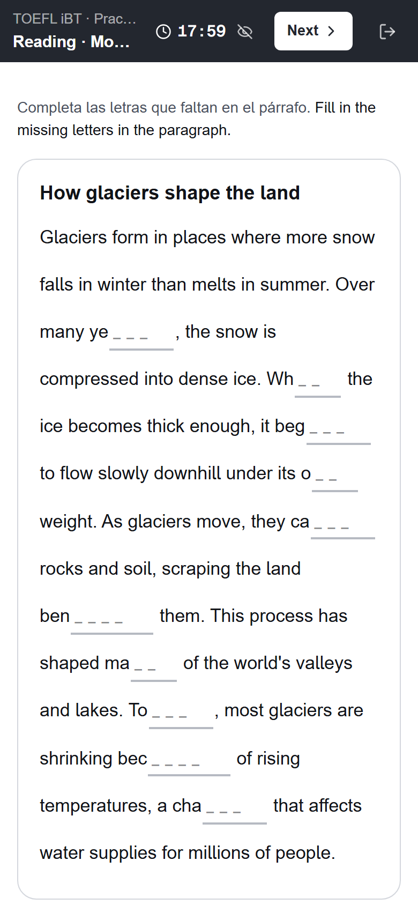

# Umbral · TOEFL iBT (2026) & IELTS Academic

Web gratuita para preparar el **TOEFL iBT en su formato de 2026** (escala 1–6, adaptativo) y el **IELTS Academic**, lo más fiel posible a los exámenes reales. Funciona sin servidor, se instala como app en el móvil (PWA) y guarda el progreso en el navegador.

> Las notas de Umbral son **estimaciones orientativas**, no oficiales. Umbral no está afiliado a ETS, British Council, IDP ni Cambridge. Todo el material de examen es original.



## Qué incluye

- **Selección de examen** (TOEFL iBT 2026 / IELTS Academic), perfil, nota objetivo y fecha. Todo se adapta al examen elegido y se puede cambiar en cualquier momento. Interfaz ES/EN, modo claro y oscuro.
- **Inicio:** cuenta atrás, racha, minutos, XP, nota estimada por destreza frente al objetivo (radar), plan de estudio diario generado según las semanas que quedan y tus puntos débiles, historial de simulacros y «fallas el X % de los Not Given».
- **Study Room:** 55 guías en español (cada tarea: qué piden, trampas, estrategia, tiempo y ejemplo resuelto; rúbricas explicadas; plantillas de Writing), **AWL completa (570 familias)** y 33 mazos temáticos con flashcards SM-2, audio TTS y modo test; 16 temas de gramática con ejercicios; conectores por función y registro; 58 vídeos de YouTube verificados (los de TOEFL, sólo del formato 2026); recursos oficiales gratuitos.
- **Práctica** por tipo de tarea con corrección inmediata, explicación de cada opción y la frase del texto o la transcripción resaltada. Listening con voces y acentos variados, velocidad, transcripción desbloqueable y dictado. Reading con interfaz de examen (texto | preguntas, resaltador, notas, marcar para revisar).
- **Writing:** editor con contador y temporizador, aviso de mínimo, LanguageTool, analizador propio (variedad léxica, % AWL, conectores, repeticiones, registro), checklist del enunciado, nota estimada por criterio, modelos comentados de varios niveles, autoevaluación y corrección opcional con Gemini.
- **Speaking:** grabación, transcripción en vivo, tiempos del examen (Part 2 con 1 min de preparación y notas), palabras por minuto, pausas, muletillas, precisión palabra a palabra en Listen and Repeat, nota estimada, modelos con audio y Gemini opcional.
- **Grammar & Vocabulary drills** de 5–10 minutos (160 ejercicios), marcados como entrenamiento, no como sección del examen.
- **Simulacros:** 4 TOEFL y 4 IELTS completos (también por secciones), con orden, tiempos e interfaz tipo examen por ordenador, adaptatividad de dos módulos en TOEFL, una sola escucha y 2 min de revisión en IELTS, paleta de preguntas, temporizador ocultable, modo flexible (con pausa, indicado en el informe), autoguardado y reanudación.
- **Informe tipo score report:** nota por sección y global (TOEFL 1–6 + 0–120 comparable + MCER; IELTS bandas 0–9), comparación con requisitos («SJTU: te falta 0.5 en W»), desglose por tipo de pregunta, tiempo por bloque, revisión pregunta a pregunta y recomendaciones con enlaces.

**Contenido:** 4 simulacros completos de cada examen y un banco de práctica de ~520 ejercicios (346 de TOEFL y 175 de IELTS), con más de 260 marcados como difíciles (filtro «difíciles» en Práctica). Writing con modelos comentados de varios niveles y gráficos de Task 1 generados con datos (7 tipos). Formatos verificados en fuentes oficiales: ver [`docs/FORMATOS.md`](docs/FORMATOS.md).

| | |
|---|---|
|  |  |
|  |  |
|  |  |

<p>



</p>

## Usarla en local

Necesitas Node 20 o superior.

```bash
npm install
npm run dev          # http://localhost:5173
npm test             # tests de motores de puntuación + validación de todo el contenido
npm run build        # compila a dist/
npm run preview      # sirve dist/ en http://localhost:4173
```

Recomendado: **Chrome o Edge** (tienen más voces para el Listening y reconocimiento de voz para el Speaking).

## Publicarla en GitHub Pages (paso a paso)

1. Crea una cuenta en GitHub si no la tienes y, en <https://github.com/new>, crea un repositorio **público** llamado, por ejemplo, `umbral` (sin README, sin .gitignore).
2. En una terminal, dentro de la carpeta del proyecto:
   ```bash
   cd "C:\CHINA\PRACTICA INGLES\web"
   git add -A
   git commit -m "Umbral: primera versión"
   git branch -M main
   git remote add origin https://github.com/TU_USUARIO/umbral.git
   git push -u origin main
   ```
   (Con la CLI de GitHub puedes hacer los pasos 1 y 2 de una vez: `gh repo create umbral --public --source . --push`.)
3. En el repositorio, ve a **Settings → Pages** y, en **Build and deployment → Source**, elige **GitHub Actions**.
4. Ve a la pestaña **Actions**: el workflow «Deploy to GitHub Pages» se ejecuta en cada push a `main` (tests → build → publicación). Si el primer intento se lanzó antes del paso 3, pulsa **Re-run all jobs**.
5. La web quedará en **`https://TU_USUARIO.github.io/umbral/`**. Comparte ese enlace con tu amiga; en el móvil, «Añadir a pantalla de inicio» la instala como app.

Cada persona tiene su progreso en su navegador. Para pasarlo de un dispositivo a otro: **Ajustes → Exportar progreso** y luego **Importar** en el otro.

## Añadir contenido

Todo el contenido está en `src/content/**` como JSON. El esquema y las reglas están en [`docs/CONTENIDO.md`](docs/CONTENIDO.md). Añade o edita un archivo, ejecuta `npm run test:content` y la app lo detecta sola.

## Lo que no se ha podido hacer gratis o con fidelidad total

- **Puntuación oficial.** ETS no publica cómo convierte aciertos en bandas de sección ni cómo puntúa su IA; IELTS sólo publica tablas aproximadas. Las notas por sección son estimaciones (las fórmulas oficiales de nota global, 0–120 y MCER sí son exactas).
- **Pronunciación.** Sin un servicio de pago no se puede evaluar acento, entonación ni ritmo. Umbral mide fluidez (palabras/min, pausas, muletillas), léxico y precisión de repetición; la pronunciación se autoevalúa.
- **Writing y Speaking** se estiman con métricas automáticas + LanguageTool; son orientativos. La corrección con Gemini mejora el feedback pero también es una estimación.
- **Audio:** se genera con las voces del navegador, no con grabaciones humanas. Las voces dependen del sistema (Windows/Chrome/Edge tienen varias; a veces falta algún acento, p. ej. neozelandés, y se usa el más cercano). No hay ruido de fondo ni solapamientos naturales.
- **Reconocimiento de voz** sólo en Chrome/Edge (usa los servidores del navegador). En Firefox/Safari se graba y se puede escribir la transcripción a mano.
- **Speaking IELTS** es con un «examinador» de voz sintética que no repregunta según tus respuestas.
- **Adaptatividad TOEFL:** el umbral de enrutado (60 %) y los tiempos por tarea son aproximaciones razonables; ETS no los publica con detalle.
- **Sincronización entre dispositivos:** no hay backend; se usa exportar/importar.
- **Reanudar a mitad de un audio:** si cierras la pestaña durante un audio, esa parte vuelve a empezar (los textos y respuestas sí se guardan).
- **Vídeos:** dependen de YouTube; algún vídeo podría dejar de estar disponible.

## Ideas de mejora

- Más simulacros (la estructura admite cualquier número: añade sets con `"usage": "mock", "mock": 5`; la app los detecta sola).
- Audios de Listening con voces neuronales pregrabadas (p. ej. generadas una vez y guardadas como MP3 en el repo) para independizarse del navegador.
- Banco de preguntas «inteligente»: priorizar automáticamente los tipos de pregunta con peor acierto.
- Modelos intermedios (TOEFL 4, IELTS 7) en todas las tareas de Writing.
- Sincronización opcional con un Gist privado de GitHub.
- Calibrar las tablas de estimación con resultados reales vuestros (anotad la nota oficial cuando la tengáis).
- Más idiomas de interfaz y un modo «sólo móvil» para drills rápidos sin conexión.

## Estructura

```
src/
  content/       JSON del contenido + schema.ts (Zod) + validación
  engine/        puntuación TOEFL/IELTS, corrección, SRS, análisis de textos, speaking, TTS, voz, IA, plan
  features/      onboarding, dashboard, study, practice, exam, history, settings
  components/    UI (Radix), preguntas, gráficos, layout
docs/            FORMATOS.md, CONTENIDO.md, DECISIONES.md, capturas
scripts/         capturas y prueba de humo con Playwright, iconos
```

Más detalles: [`docs/DECISIONES.md`](docs/DECISIONES.md).
